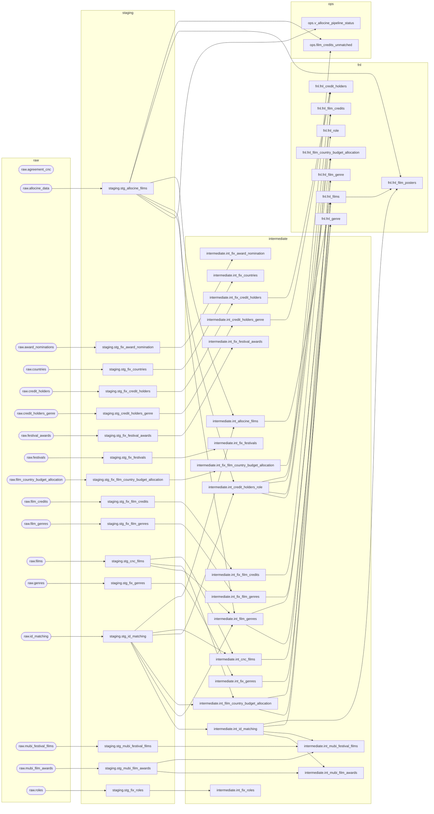
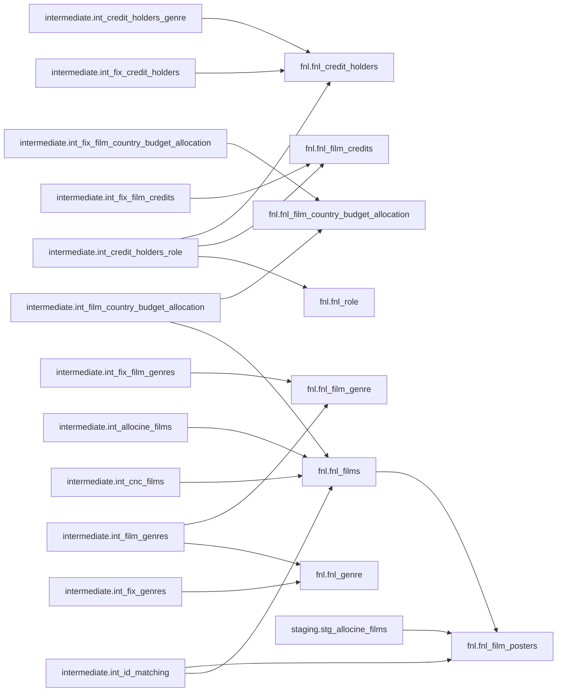
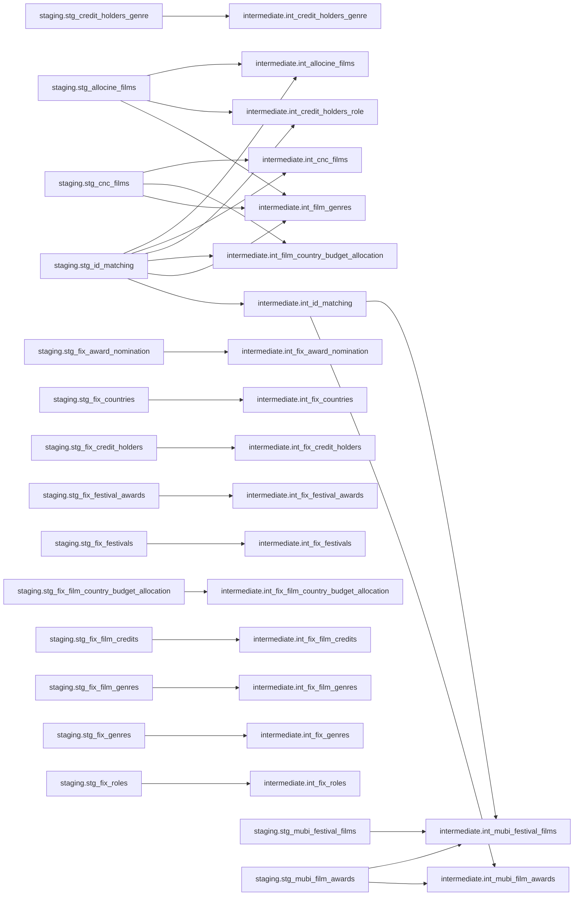
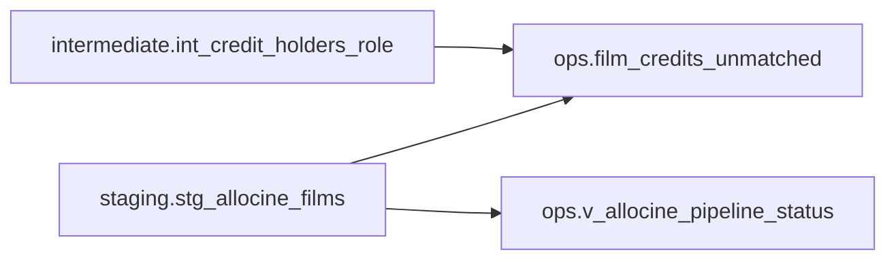
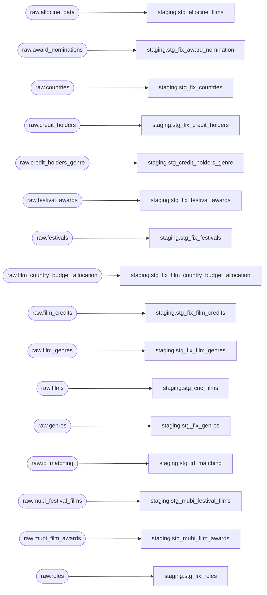

# Lineage dbt — ingestion RIC

**Owner:** Joel Teixeira

**Dernière révision:** 2026-11-14

**Status:** actif

Dépendances déclarées dans le projet dbt, des sources vers les modèles consommateurs.
[Version du code analysée](https://github.com/Le-Collectif-50-50/cinestats-5050/tree/e74eb57977702e64282f87aa6fa8c6fc4f58ac78).

17 sources, 45 modèles, 0 seeds, 0 snapshots ; 66 dépendances directes.

Généré avec `dbt parse` puis `scripts/generate_dbt_lineage.py`. Aucune connexion à PostgreSQL. Les flèches suivent les appels `ref()` et `source()` du manifest ; les références SQL écrites en dur ne sont pas déduites.

Ce document décrit les dépendances entre relations, pas entre colonnes. Il ne prouve ni la présence des tables en base, ni le succès des traitements. Les tests, analyses, macros, modèles désactivés et traitements externes Airbyte/Prefect/scraping sont hors graphe.

## Lineage dbt complet

Cette vue rassemble toutes les relations actives du manifest, y compris celles sans dépendance. Suivre les flèches de gauche à droite pour parcourir les chaînes des sources brutes jusqu’aux modèles finaux et opérationnels. Les cadres regroupent les relations par schéma ; les sources brutes sont arrondies.

## Vues détaillées par schéma

Afficher les diagrammes par schéma consommateur

Chaque diagramme montre les relations du schéma et leurs parents directs. Une relation peut donc apparaître dans plusieurs diagrammes. Les sources brutes sont arrondies ; les transformations sont rectangulaires.

### fnl

### intermediate

### ops

### staging

## Inventaire et dépendances directes

Les liens ouvrent les définitions à la version du code analysée.

| Relation | Type | Matérialisation | Parents directs |
| --- | --- | --- | --- |
| [ops.film_credits_unmatched](https://github.com/Le-Collectif-50-50/cinestats-5050/tree/e74eb57977702e64282f87aa6fa8c6fc4f58ac78/ingestion/dbt/models/ops/film_credits_unmatched.sql) | model | table | [intermediate.int_credit_holders_role](https://github.com/Le-Collectif-50-50/cinestats-5050/tree/e74eb57977702e64282f87aa6fa8c6fc4f58ac78/ingestion/dbt/models/intermediate/int_credit_holders_role.sql), [staging.stg_allocine_films](https://github.com/Le-Collectif-50-50/cinestats-5050/tree/e74eb57977702e64282f87aa6fa8c6fc4f58ac78/ingestion/dbt/models/staging/stg_allocine_films.sql) |
| [fnl.fnl_credit_holders](https://github.com/Le-Collectif-50-50/cinestats-5050/tree/e74eb57977702e64282f87aa6fa8c6fc4f58ac78/ingestion/dbt/models/fnl/fnl_credit_holders.sql) | model | table | [intermediate.int_credit_holders_genre](https://github.com/Le-Collectif-50-50/cinestats-5050/tree/e74eb57977702e64282f87aa6fa8c6fc4f58ac78/ingestion/dbt/models/intermediate/int_credit_holders_genre.sql), [intermediate.int_credit_holders_role](https://github.com/Le-Collectif-50-50/cinestats-5050/tree/e74eb57977702e64282f87aa6fa8c6fc4f58ac78/ingestion/dbt/models/intermediate/int_credit_holders_role.sql), [intermediate.int_fix_credit_holders](https://github.com/Le-Collectif-50-50/cinestats-5050/tree/e74eb57977702e64282f87aa6fa8c6fc4f58ac78/ingestion/dbt/models/intermediate/int_fix_credit_holders.sql) |
| [fnl.fnl_film_country_budget_allocation](https://github.com/Le-Collectif-50-50/cinestats-5050/tree/e74eb57977702e64282f87aa6fa8c6fc4f58ac78/ingestion/dbt/models/fnl/fnl_film_country_budget_allocation.sql) | model | table | [intermediate.int_film_country_budget_allocation](https://github.com/Le-Collectif-50-50/cinestats-5050/tree/e74eb57977702e64282f87aa6fa8c6fc4f58ac78/ingestion/dbt/models/intermediate/int_film_country_budget_allocation.sql), [intermediate.int_fix_film_country_budget_allocation](https://github.com/Le-Collectif-50-50/cinestats-5050/tree/e74eb57977702e64282f87aa6fa8c6fc4f58ac78/ingestion/dbt/models/intermediate/int_fix_film_country_budget_allocation.sql) |
| [fnl.fnl_film_credits](https://github.com/Le-Collectif-50-50/cinestats-5050/tree/e74eb57977702e64282f87aa6fa8c6fc4f58ac78/ingestion/dbt/models/fnl/fnl_film_credits.sql) | model | table | [intermediate.int_credit_holders_role](https://github.com/Le-Collectif-50-50/cinestats-5050/tree/e74eb57977702e64282f87aa6fa8c6fc4f58ac78/ingestion/dbt/models/intermediate/int_credit_holders_role.sql), [intermediate.int_fix_film_credits](https://github.com/Le-Collectif-50-50/cinestats-5050/tree/e74eb57977702e64282f87aa6fa8c6fc4f58ac78/ingestion/dbt/models/intermediate/int_fix_film_credits.sql) |
| [fnl.fnl_film_genre](https://github.com/Le-Collectif-50-50/cinestats-5050/tree/e74eb57977702e64282f87aa6fa8c6fc4f58ac78/ingestion/dbt/models/fnl/fnl_film_genre.sql) | model | table | [intermediate.int_film_genres](https://github.com/Le-Collectif-50-50/cinestats-5050/tree/e74eb57977702e64282f87aa6fa8c6fc4f58ac78/ingestion/dbt/models/intermediate/int_film_genres.sql), [intermediate.int_fix_film_genres](https://github.com/Le-Collectif-50-50/cinestats-5050/tree/e74eb57977702e64282f87aa6fa8c6fc4f58ac78/ingestion/dbt/models/intermediate/int_fix_film_genres.sql) |
| [fnl.fnl_film_posters](https://github.com/Le-Collectif-50-50/cinestats-5050/tree/e74eb57977702e64282f87aa6fa8c6fc4f58ac78/ingestion/dbt/models/fnl/fnl_film_posters.sql) | model | view | [fnl.fnl_films](https://github.com/Le-Collectif-50-50/cinestats-5050/tree/e74eb57977702e64282f87aa6fa8c6fc4f58ac78/ingestion/dbt/models/fnl/fnl_films.sql), [intermediate.int_id_matching](https://github.com/Le-Collectif-50-50/cinestats-5050/tree/e74eb57977702e64282f87aa6fa8c6fc4f58ac78/ingestion/dbt/models/intermediate/int_id_matching.sql), [staging.stg_allocine_films](https://github.com/Le-Collectif-50-50/cinestats-5050/tree/e74eb57977702e64282f87aa6fa8c6fc4f58ac78/ingestion/dbt/models/staging/stg_allocine_films.sql) |
| [fnl.fnl_films](https://github.com/Le-Collectif-50-50/cinestats-5050/tree/e74eb57977702e64282f87aa6fa8c6fc4f58ac78/ingestion/dbt/models/fnl/fnl_films.sql) | model | table | [intermediate.int_allocine_films](https://github.com/Le-Collectif-50-50/cinestats-5050/tree/e74eb57977702e64282f87aa6fa8c6fc4f58ac78/ingestion/dbt/models/intermediate/int_allocine_films.sql), [intermediate.int_cnc_films](https://github.com/Le-Collectif-50-50/cinestats-5050/tree/e74eb57977702e64282f87aa6fa8c6fc4f58ac78/ingestion/dbt/models/intermediate/int_cnc_films.sql), [intermediate.int_film_country_budget_allocation](https://github.com/Le-Collectif-50-50/cinestats-5050/tree/e74eb57977702e64282f87aa6fa8c6fc4f58ac78/ingestion/dbt/models/intermediate/int_film_country_budget_allocation.sql), [intermediate.int_id_matching](https://github.com/Le-Collectif-50-50/cinestats-5050/tree/e74eb57977702e64282f87aa6fa8c6fc4f58ac78/ingestion/dbt/models/intermediate/int_id_matching.sql) |
| [fnl.fnl_genre](https://github.com/Le-Collectif-50-50/cinestats-5050/tree/e74eb57977702e64282f87aa6fa8c6fc4f58ac78/ingestion/dbt/models/fnl/fnl_genre.sql) | model | table | [intermediate.int_film_genres](https://github.com/Le-Collectif-50-50/cinestats-5050/tree/e74eb57977702e64282f87aa6fa8c6fc4f58ac78/ingestion/dbt/models/intermediate/int_film_genres.sql), [intermediate.int_fix_genres](https://github.com/Le-Collectif-50-50/cinestats-5050/tree/e74eb57977702e64282f87aa6fa8c6fc4f58ac78/ingestion/dbt/models/intermediate/int_fix_genres.sql) |
| [fnl.fnl_role](https://github.com/Le-Collectif-50-50/cinestats-5050/tree/e74eb57977702e64282f87aa6fa8c6fc4f58ac78/ingestion/dbt/models/fnl/fnl_role.sql) | model | table | [intermediate.int_credit_holders_role](https://github.com/Le-Collectif-50-50/cinestats-5050/tree/e74eb57977702e64282f87aa6fa8c6fc4f58ac78/ingestion/dbt/models/intermediate/int_credit_holders_role.sql) |
| [intermediate.int_allocine_films](https://github.com/Le-Collectif-50-50/cinestats-5050/tree/e74eb57977702e64282f87aa6fa8c6fc4f58ac78/ingestion/dbt/models/intermediate/int_allocine_films.sql) | model | view | [staging.stg_allocine_films](https://github.com/Le-Collectif-50-50/cinestats-5050/tree/e74eb57977702e64282f87aa6fa8c6fc4f58ac78/ingestion/dbt/models/staging/stg_allocine_films.sql), [staging.stg_id_matching](https://github.com/Le-Collectif-50-50/cinestats-5050/tree/e74eb57977702e64282f87aa6fa8c6fc4f58ac78/ingestion/dbt/models/staging/stg_id_matching.sql) |
| [intermediate.int_cnc_films](https://github.com/Le-Collectif-50-50/cinestats-5050/tree/e74eb57977702e64282f87aa6fa8c6fc4f58ac78/ingestion/dbt/models/intermediate/int_cnc_films.sql) | model | view | [staging.stg_cnc_films](https://github.com/Le-Collectif-50-50/cinestats-5050/tree/e74eb57977702e64282f87aa6fa8c6fc4f58ac78/ingestion/dbt/models/staging/stg_cnc_films.sql), [staging.stg_id_matching](https://github.com/Le-Collectif-50-50/cinestats-5050/tree/e74eb57977702e64282f87aa6fa8c6fc4f58ac78/ingestion/dbt/models/staging/stg_id_matching.sql) |
| [intermediate.int_credit_holders_genre](https://github.com/Le-Collectif-50-50/cinestats-5050/tree/e74eb57977702e64282f87aa6fa8c6fc4f58ac78/ingestion/dbt/models/intermediate/int_credit_holders_genre.sql) | model | view | [staging.stg_credit_holders_genre](https://github.com/Le-Collectif-50-50/cinestats-5050/tree/e74eb57977702e64282f87aa6fa8c6fc4f58ac78/ingestion/dbt/models/staging/stg_credit_holders_genre.sql) |
| [intermediate.int_credit_holders_role](https://github.com/Le-Collectif-50-50/cinestats-5050/tree/e74eb57977702e64282f87aa6fa8c6fc4f58ac78/ingestion/dbt/models/intermediate/int_credit_holders_role.sql) | model | view | [staging.stg_allocine_films](https://github.com/Le-Collectif-50-50/cinestats-5050/tree/e74eb57977702e64282f87aa6fa8c6fc4f58ac78/ingestion/dbt/models/staging/stg_allocine_films.sql), [staging.stg_id_matching](https://github.com/Le-Collectif-50-50/cinestats-5050/tree/e74eb57977702e64282f87aa6fa8c6fc4f58ac78/ingestion/dbt/models/staging/stg_id_matching.sql) |
| [intermediate.int_film_country_budget_allocation](https://github.com/Le-Collectif-50-50/cinestats-5050/tree/e74eb57977702e64282f87aa6fa8c6fc4f58ac78/ingestion/dbt/models/intermediate/int_film_country_budget_allocation.sql) | model | view | [staging.stg_cnc_films](https://github.com/Le-Collectif-50-50/cinestats-5050/tree/e74eb57977702e64282f87aa6fa8c6fc4f58ac78/ingestion/dbt/models/staging/stg_cnc_films.sql), [staging.stg_id_matching](https://github.com/Le-Collectif-50-50/cinestats-5050/tree/e74eb57977702e64282f87aa6fa8c6fc4f58ac78/ingestion/dbt/models/staging/stg_id_matching.sql) |
| [intermediate.int_film_genres](https://github.com/Le-Collectif-50-50/cinestats-5050/tree/e74eb57977702e64282f87aa6fa8c6fc4f58ac78/ingestion/dbt/models/intermediate/int_film_genres.sql) | model | view | [staging.stg_allocine_films](https://github.com/Le-Collectif-50-50/cinestats-5050/tree/e74eb57977702e64282f87aa6fa8c6fc4f58ac78/ingestion/dbt/models/staging/stg_allocine_films.sql), [staging.stg_cnc_films](https://github.com/Le-Collectif-50-50/cinestats-5050/tree/e74eb57977702e64282f87aa6fa8c6fc4f58ac78/ingestion/dbt/models/staging/stg_cnc_films.sql), [staging.stg_id_matching](https://github.com/Le-Collectif-50-50/cinestats-5050/tree/e74eb57977702e64282f87aa6fa8c6fc4f58ac78/ingestion/dbt/models/staging/stg_id_matching.sql) |
| [intermediate.int_fix_award_nomination](https://github.com/Le-Collectif-50-50/cinestats-5050/tree/e74eb57977702e64282f87aa6fa8c6fc4f58ac78/ingestion/dbt/models/intermediate/int_fix_award_nomination.sql) | model | view | [staging.stg_fix_award_nomination](https://github.com/Le-Collectif-50-50/cinestats-5050/tree/e74eb57977702e64282f87aa6fa8c6fc4f58ac78/ingestion/dbt/models/staging/stg_fix_award_nomination.sql) |
| [intermediate.int_fix_countries](https://github.com/Le-Collectif-50-50/cinestats-5050/tree/e74eb57977702e64282f87aa6fa8c6fc4f58ac78/ingestion/dbt/models/intermediate/int_fix_countries.sql) | model | view | [staging.stg_fix_countries](https://github.com/Le-Collectif-50-50/cinestats-5050/tree/e74eb57977702e64282f87aa6fa8c6fc4f58ac78/ingestion/dbt/models/staging/stg_fix_countries.sql) |
| [intermediate.int_fix_credit_holders](https://github.com/Le-Collectif-50-50/cinestats-5050/tree/e74eb57977702e64282f87aa6fa8c6fc4f58ac78/ingestion/dbt/models/intermediate/int_fix_credit_holders.sql) | model | view | [staging.stg_fix_credit_holders](https://github.com/Le-Collectif-50-50/cinestats-5050/tree/e74eb57977702e64282f87aa6fa8c6fc4f58ac78/ingestion/dbt/models/staging/stg_fix_credit_holders.sql) |
| [intermediate.int_fix_festival_awards](https://github.com/Le-Collectif-50-50/cinestats-5050/tree/e74eb57977702e64282f87aa6fa8c6fc4f58ac78/ingestion/dbt/models/intermediate/int_fix_festival_awards.sql) | model | view | [staging.stg_fix_festival_awards](https://github.com/Le-Collectif-50-50/cinestats-5050/tree/e74eb57977702e64282f87aa6fa8c6fc4f58ac78/ingestion/dbt/models/staging/stg_fix_festival_awards.sql) |
| [intermediate.int_fix_festivals](https://github.com/Le-Collectif-50-50/cinestats-5050/tree/e74eb57977702e64282f87aa6fa8c6fc4f58ac78/ingestion/dbt/models/intermediate/int_fix_festivals.sql) | model | view | [staging.stg_fix_festivals](https://github.com/Le-Collectif-50-50/cinestats-5050/tree/e74eb57977702e64282f87aa6fa8c6fc4f58ac78/ingestion/dbt/models/staging/stg_fix_festivals.sql) |
| [intermediate.int_fix_film_country_budget_allocation](https://github.com/Le-Collectif-50-50/cinestats-5050/tree/e74eb57977702e64282f87aa6fa8c6fc4f58ac78/ingestion/dbt/models/intermediate/int_fix_film_country_budget_allocation.sql) | model | view | [staging.stg_fix_film_country_budget_allocation](https://github.com/Le-Collectif-50-50/cinestats-5050/tree/e74eb57977702e64282f87aa6fa8c6fc4f58ac78/ingestion/dbt/models/staging/stg_fix_film_country_budget_allocation.sql) |
| [intermediate.int_fix_film_credits](https://github.com/Le-Collectif-50-50/cinestats-5050/tree/e74eb57977702e64282f87aa6fa8c6fc4f58ac78/ingestion/dbt/models/intermediate/int_fix_film_credits.sql) | model | view | [staging.stg_fix_film_credits](https://github.com/Le-Collectif-50-50/cinestats-5050/tree/e74eb57977702e64282f87aa6fa8c6fc4f58ac78/ingestion/dbt/models/staging/stg_fix_film_credits.sql) |
| [intermediate.int_fix_film_genres](https://github.com/Le-Collectif-50-50/cinestats-5050/tree/e74eb57977702e64282f87aa6fa8c6fc4f58ac78/ingestion/dbt/models/intermediate/int_fix_film_genres.sql) | model | view | [staging.stg_fix_film_genres](https://github.com/Le-Collectif-50-50/cinestats-5050/tree/e74eb57977702e64282f87aa6fa8c6fc4f58ac78/ingestion/dbt/models/staging/stg_fix_film_genres.sql) |
| [intermediate.int_fix_genres](https://github.com/Le-Collectif-50-50/cinestats-5050/tree/e74eb57977702e64282f87aa6fa8c6fc4f58ac78/ingestion/dbt/models/intermediate/int_fix_genres.sql) | model | view | [staging.stg_fix_genres](https://github.com/Le-Collectif-50-50/cinestats-5050/tree/e74eb57977702e64282f87aa6fa8c6fc4f58ac78/ingestion/dbt/models/staging/stg_fix_genres.sql) |
| [intermediate.int_fix_roles](https://github.com/Le-Collectif-50-50/cinestats-5050/tree/e74eb57977702e64282f87aa6fa8c6fc4f58ac78/ingestion/dbt/models/intermediate/int_fix_roles.sql) | model | view | [staging.stg_fix_roles](https://github.com/Le-Collectif-50-50/cinestats-5050/tree/e74eb57977702e64282f87aa6fa8c6fc4f58ac78/ingestion/dbt/models/staging/stg_fix_roles.sql) |
| [intermediate.int_id_matching](https://github.com/Le-Collectif-50-50/cinestats-5050/tree/e74eb57977702e64282f87aa6fa8c6fc4f58ac78/ingestion/dbt/models/intermediate/int_id_matching.sql) | model | view | [staging.stg_id_matching](https://github.com/Le-Collectif-50-50/cinestats-5050/tree/e74eb57977702e64282f87aa6fa8c6fc4f58ac78/ingestion/dbt/models/staging/stg_id_matching.sql) |
| [intermediate.int_mubi_festival_films](https://github.com/Le-Collectif-50-50/cinestats-5050/tree/e74eb57977702e64282f87aa6fa8c6fc4f58ac78/ingestion/dbt/models/intermediate/int_mubi_festival_films.sql) | model | table | [intermediate.int_id_matching](https://github.com/Le-Collectif-50-50/cinestats-5050/tree/e74eb57977702e64282f87aa6fa8c6fc4f58ac78/ingestion/dbt/models/intermediate/int_id_matching.sql), [staging.stg_mubi_festival_films](https://github.com/Le-Collectif-50-50/cinestats-5050/tree/e74eb57977702e64282f87aa6fa8c6fc4f58ac78/ingestion/dbt/models/staging/stg_mubi_festival_films.sql), [staging.stg_mubi_film_awards](https://github.com/Le-Collectif-50-50/cinestats-5050/tree/e74eb57977702e64282f87aa6fa8c6fc4f58ac78/ingestion/dbt/models/staging/stg_mubi_film_awards.sql) |
| [intermediate.int_mubi_film_awards](https://github.com/Le-Collectif-50-50/cinestats-5050/tree/e74eb57977702e64282f87aa6fa8c6fc4f58ac78/ingestion/dbt/models/intermediate/int_mubi_film_awards.sql) | model | table | [intermediate.int_id_matching](https://github.com/Le-Collectif-50-50/cinestats-5050/tree/e74eb57977702e64282f87aa6fa8c6fc4f58ac78/ingestion/dbt/models/intermediate/int_id_matching.sql), [staging.stg_mubi_film_awards](https://github.com/Le-Collectif-50-50/cinestats-5050/tree/e74eb57977702e64282f87aa6fa8c6fc4f58ac78/ingestion/dbt/models/staging/stg_mubi_film_awards.sql) |
| [staging.stg_allocine_films](https://github.com/Le-Collectif-50-50/cinestats-5050/tree/e74eb57977702e64282f87aa6fa8c6fc4f58ac78/ingestion/dbt/models/staging/stg_allocine_films.sql) | model | table | [raw.allocine_data](https://github.com/Le-Collectif-50-50/cinestats-5050/tree/e74eb57977702e64282f87aa6fa8c6fc4f58ac78/ingestion/dbt/models/sources.yml) |
| [staging.stg_cnc_films](https://github.com/Le-Collectif-50-50/cinestats-5050/tree/e74eb57977702e64282f87aa6fa8c6fc4f58ac78/ingestion/dbt/models/staging/stg_cnc_films.sql) | model | table | [raw.films](https://github.com/Le-Collectif-50-50/cinestats-5050/tree/e74eb57977702e64282f87aa6fa8c6fc4f58ac78/ingestion/dbt/models/sources.yml) |
| [staging.stg_credit_holders_genre](https://github.com/Le-Collectif-50-50/cinestats-5050/tree/e74eb57977702e64282f87aa6fa8c6fc4f58ac78/ingestion/dbt/models/staging/stg_credit_holders_genre.sql) | model | table | [raw.credit_holders_genre](https://github.com/Le-Collectif-50-50/cinestats-5050/tree/e74eb57977702e64282f87aa6fa8c6fc4f58ac78/ingestion/dbt/models/sources.yml) |
| [staging.stg_fix_award_nomination](https://github.com/Le-Collectif-50-50/cinestats-5050/tree/e74eb57977702e64282f87aa6fa8c6fc4f58ac78/ingestion/dbt/models/staging/stg_fix_award_nomination.sql) | model | table | [raw.award_nominations](https://github.com/Le-Collectif-50-50/cinestats-5050/tree/e74eb57977702e64282f87aa6fa8c6fc4f58ac78/ingestion/dbt/models/sources.yml) |
| [staging.stg_fix_countries](https://github.com/Le-Collectif-50-50/cinestats-5050/tree/e74eb57977702e64282f87aa6fa8c6fc4f58ac78/ingestion/dbt/models/staging/stg_fix_countries.sql) | model | table | [raw.countries](https://github.com/Le-Collectif-50-50/cinestats-5050/tree/e74eb57977702e64282f87aa6fa8c6fc4f58ac78/ingestion/dbt/models/sources.yml) |
| [staging.stg_fix_credit_holders](https://github.com/Le-Collectif-50-50/cinestats-5050/tree/e74eb57977702e64282f87aa6fa8c6fc4f58ac78/ingestion/dbt/models/staging/stg_fix_credit_holders.sql) | model | table | [raw.credit_holders](https://github.com/Le-Collectif-50-50/cinestats-5050/tree/e74eb57977702e64282f87aa6fa8c6fc4f58ac78/ingestion/dbt/models/sources.yml) |
| [staging.stg_fix_festival_awards](https://github.com/Le-Collectif-50-50/cinestats-5050/tree/e74eb57977702e64282f87aa6fa8c6fc4f58ac78/ingestion/dbt/models/staging/stg_fix_festival_awards.sql) | model | table | [raw.festival_awards](https://github.com/Le-Collectif-50-50/cinestats-5050/tree/e74eb57977702e64282f87aa6fa8c6fc4f58ac78/ingestion/dbt/models/sources.yml) |
| [staging.stg_fix_festivals](https://github.com/Le-Collectif-50-50/cinestats-5050/tree/e74eb57977702e64282f87aa6fa8c6fc4f58ac78/ingestion/dbt/models/staging/stg_fix_festivals.sql) | model | table | [raw.festivals](https://github.com/Le-Collectif-50-50/cinestats-5050/tree/e74eb57977702e64282f87aa6fa8c6fc4f58ac78/ingestion/dbt/models/sources.yml) |
| [staging.stg_fix_film_country_budget_allocation](https://github.com/Le-Collectif-50-50/cinestats-5050/tree/e74eb57977702e64282f87aa6fa8c6fc4f58ac78/ingestion/dbt/models/staging/stg_fix_film_country_budget_allocation.sql) | model | table | [raw.film_country_budget_allocation](https://github.com/Le-Collectif-50-50/cinestats-5050/tree/e74eb57977702e64282f87aa6fa8c6fc4f58ac78/ingestion/dbt/models/sources.yml) |
| [staging.stg_fix_film_credits](https://github.com/Le-Collectif-50-50/cinestats-5050/tree/e74eb57977702e64282f87aa6fa8c6fc4f58ac78/ingestion/dbt/models/staging/stg_fix_film_credits.sql) | model | table | [raw.film_credits](https://github.com/Le-Collectif-50-50/cinestats-5050/tree/e74eb57977702e64282f87aa6fa8c6fc4f58ac78/ingestion/dbt/models/sources.yml) |
| [staging.stg_fix_film_genres](https://github.com/Le-Collectif-50-50/cinestats-5050/tree/e74eb57977702e64282f87aa6fa8c6fc4f58ac78/ingestion/dbt/models/staging/stg_fix_film_genres.sql) | model | table | [raw.film_genres](https://github.com/Le-Collectif-50-50/cinestats-5050/tree/e74eb57977702e64282f87aa6fa8c6fc4f58ac78/ingestion/dbt/models/sources.yml) |
| [staging.stg_fix_genres](https://github.com/Le-Collectif-50-50/cinestats-5050/tree/e74eb57977702e64282f87aa6fa8c6fc4f58ac78/ingestion/dbt/models/staging/stg_fix_genres.sql) | model | table | [raw.genres](https://github.com/Le-Collectif-50-50/cinestats-5050/tree/e74eb57977702e64282f87aa6fa8c6fc4f58ac78/ingestion/dbt/models/sources.yml) |
| [staging.stg_fix_roles](https://github.com/Le-Collectif-50-50/cinestats-5050/tree/e74eb57977702e64282f87aa6fa8c6fc4f58ac78/ingestion/dbt/models/staging/stg_fix_roles.sql) | model | table | [raw.roles](https://github.com/Le-Collectif-50-50/cinestats-5050/tree/e74eb57977702e64282f87aa6fa8c6fc4f58ac78/ingestion/dbt/models/sources.yml) |
| [staging.stg_id_matching](https://github.com/Le-Collectif-50-50/cinestats-5050/tree/e74eb57977702e64282f87aa6fa8c6fc4f58ac78/ingestion/dbt/models/staging/stg_id_matching.sql) | model | table | [raw.id_matching](https://github.com/Le-Collectif-50-50/cinestats-5050/tree/e74eb57977702e64282f87aa6fa8c6fc4f58ac78/ingestion/dbt/models/sources.yml) |
| [staging.stg_mubi_festival_films](https://github.com/Le-Collectif-50-50/cinestats-5050/tree/e74eb57977702e64282f87aa6fa8c6fc4f58ac78/ingestion/dbt/models/staging/stg_mubi_festival_films.sql) | model | table | [raw.mubi_festival_films](https://github.com/Le-Collectif-50-50/cinestats-5050/tree/e74eb57977702e64282f87aa6fa8c6fc4f58ac78/ingestion/dbt/models/sources.yml) |
| [staging.stg_mubi_film_awards](https://github.com/Le-Collectif-50-50/cinestats-5050/tree/e74eb57977702e64282f87aa6fa8c6fc4f58ac78/ingestion/dbt/models/staging/stg_mubi_film_awards.sql) | model | table | [raw.mubi_film_awards](https://github.com/Le-Collectif-50-50/cinestats-5050/tree/e74eb57977702e64282f87aa6fa8c6fc4f58ac78/ingestion/dbt/models/sources.yml) |
| [ops.v_allocine_pipeline_status](https://github.com/Le-Collectif-50-50/cinestats-5050/tree/e74eb57977702e64282f87aa6fa8c6fc4f58ac78/ingestion/dbt/models/ops/v_allocine_pipeline_status.sql) | model | table | [staging.stg_allocine_films](https://github.com/Le-Collectif-50-50/cinestats-5050/tree/e74eb57977702e64282f87aa6fa8c6fc4f58ac78/ingestion/dbt/models/staging/stg_allocine_films.sql) |
| [raw.agreement_cnc](https://github.com/Le-Collectif-50-50/cinestats-5050/tree/e74eb57977702e64282f87aa6fa8c6fc4f58ac78/ingestion/dbt/models/sources.yml) | source | — | — |
| [raw.allocine_data](https://github.com/Le-Collectif-50-50/cinestats-5050/tree/e74eb57977702e64282f87aa6fa8c6fc4f58ac78/ingestion/dbt/models/sources.yml) | source | — | — |
| [raw.award_nominations](https://github.com/Le-Collectif-50-50/cinestats-5050/tree/e74eb57977702e64282f87aa6fa8c6fc4f58ac78/ingestion/dbt/models/sources.yml) | source | — | — |
| [raw.countries](https://github.com/Le-Collectif-50-50/cinestats-5050/tree/e74eb57977702e64282f87aa6fa8c6fc4f58ac78/ingestion/dbt/models/sources.yml) | source | — | — |
| [raw.credit_holders](https://github.com/Le-Collectif-50-50/cinestats-5050/tree/e74eb57977702e64282f87aa6fa8c6fc4f58ac78/ingestion/dbt/models/sources.yml) | source | — | — |
| [raw.credit_holders_genre](https://github.com/Le-Collectif-50-50/cinestats-5050/tree/e74eb57977702e64282f87aa6fa8c6fc4f58ac78/ingestion/dbt/models/sources.yml) | source | — | — |
| [raw.festival_awards](https://github.com/Le-Collectif-50-50/cinestats-5050/tree/e74eb57977702e64282f87aa6fa8c6fc4f58ac78/ingestion/dbt/models/sources.yml) | source | — | — |
| [raw.festivals](https://github.com/Le-Collectif-50-50/cinestats-5050/tree/e74eb57977702e64282f87aa6fa8c6fc4f58ac78/ingestion/dbt/models/sources.yml) | source | — | — |
| [raw.film_country_budget_allocation](https://github.com/Le-Collectif-50-50/cinestats-5050/tree/e74eb57977702e64282f87aa6fa8c6fc4f58ac78/ingestion/dbt/models/sources.yml) | source | — | — |
| [raw.film_credits](https://github.com/Le-Collectif-50-50/cinestats-5050/tree/e74eb57977702e64282f87aa6fa8c6fc4f58ac78/ingestion/dbt/models/sources.yml) | source | — | — |
| [raw.film_genres](https://github.com/Le-Collectif-50-50/cinestats-5050/tree/e74eb57977702e64282f87aa6fa8c6fc4f58ac78/ingestion/dbt/models/sources.yml) | source | — | — |
| [raw.films](https://github.com/Le-Collectif-50-50/cinestats-5050/tree/e74eb57977702e64282f87aa6fa8c6fc4f58ac78/ingestion/dbt/models/sources.yml) | source | — | — |
| [raw.genres](https://github.com/Le-Collectif-50-50/cinestats-5050/tree/e74eb57977702e64282f87aa6fa8c6fc4f58ac78/ingestion/dbt/models/sources.yml) | source | — | — |
| [raw.id_matching](https://github.com/Le-Collectif-50-50/cinestats-5050/tree/e74eb57977702e64282f87aa6fa8c6fc4f58ac78/ingestion/dbt/models/sources.yml) | source | — | — |
| [raw.mubi_festival_films](https://github.com/Le-Collectif-50-50/cinestats-5050/tree/e74eb57977702e64282f87aa6fa8c6fc4f58ac78/ingestion/dbt/models/sources.yml) | source | — | — |
| [raw.mubi_film_awards](https://github.com/Le-Collectif-50-50/cinestats-5050/tree/e74eb57977702e64282f87aa6fa8c6fc4f58ac78/ingestion/dbt/models/sources.yml) | source | — | — |
| [raw.roles](https://github.com/Le-Collectif-50-50/cinestats-5050/tree/e74eb57977702e64282f87aa6fa8c6fc4f58ac78/ingestion/dbt/models/sources.yml) | source | — | — |

## Historique du document

| # | Date | Auteur | Observations |
| --- | --- | --- | --- |
| 1 | 2026-11-14 | Joel Teixeira | État généré depuis la version du code liée ci-dessus. |

Les versions précédentes restent disponibles dans l’historique Git de `docs/dbt-lineage.md` sur `main`.
