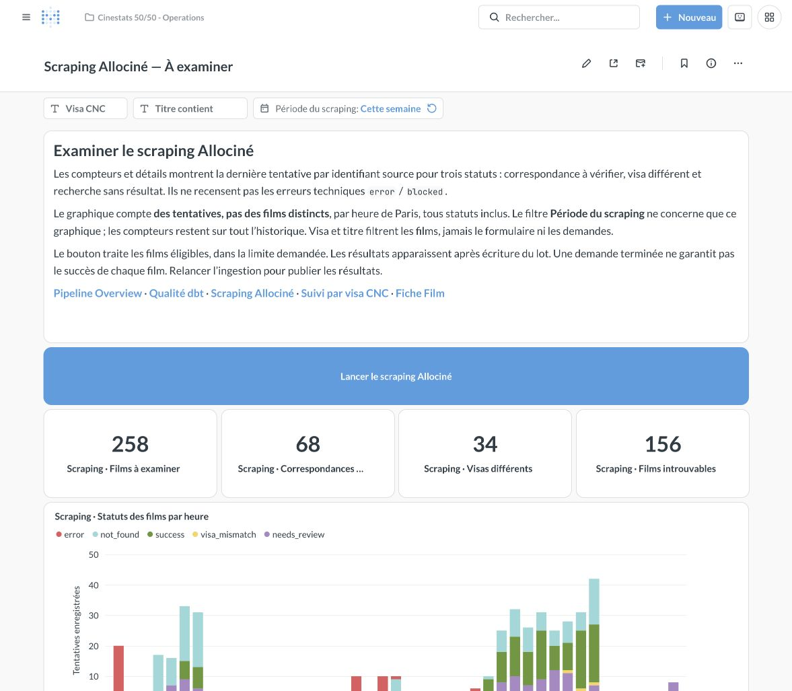
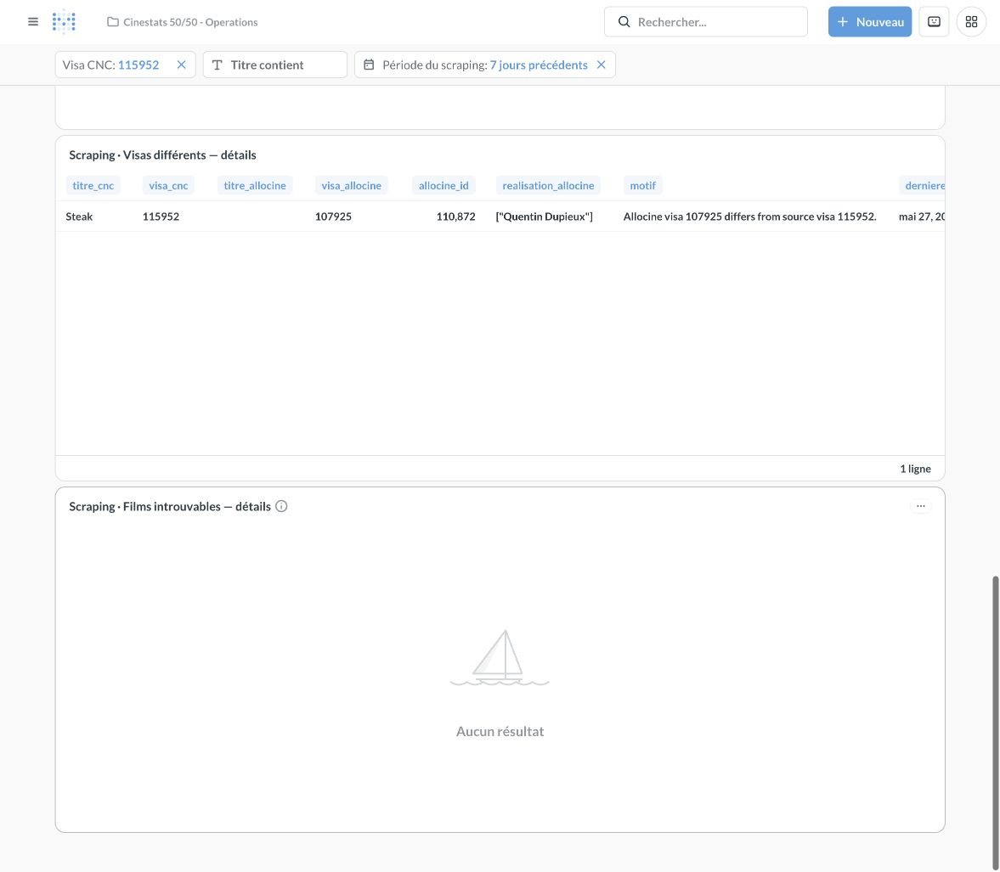
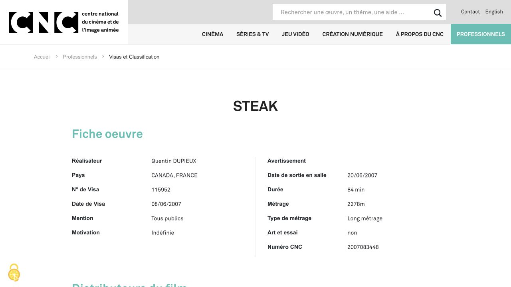
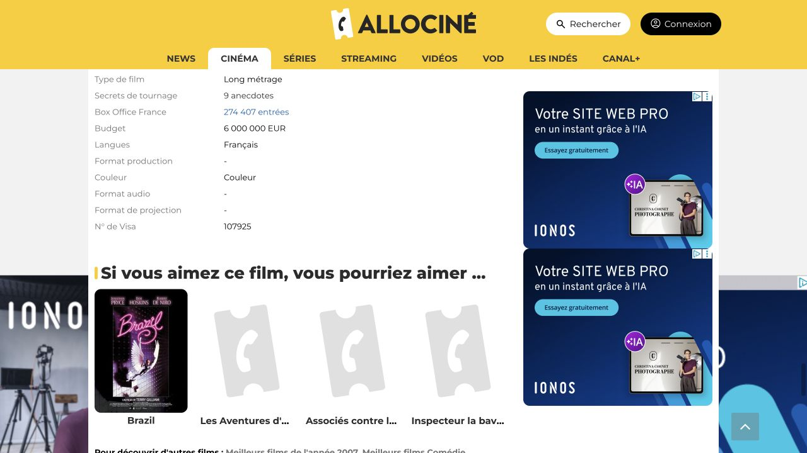
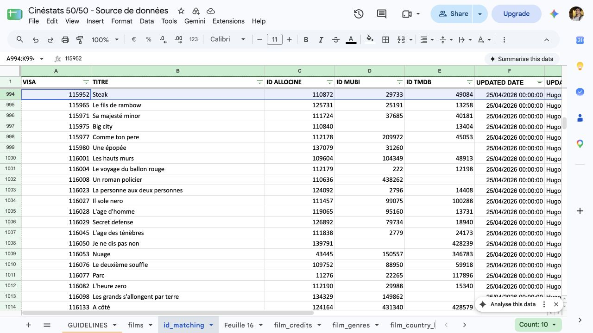
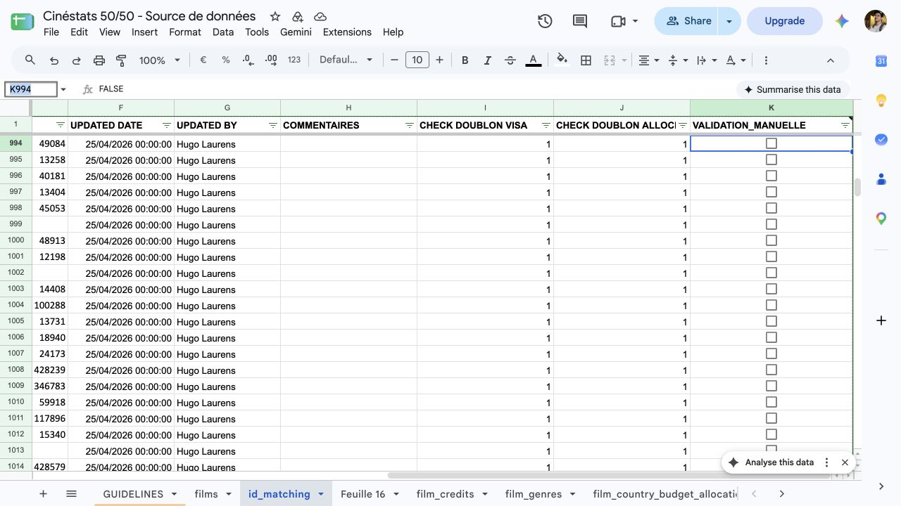
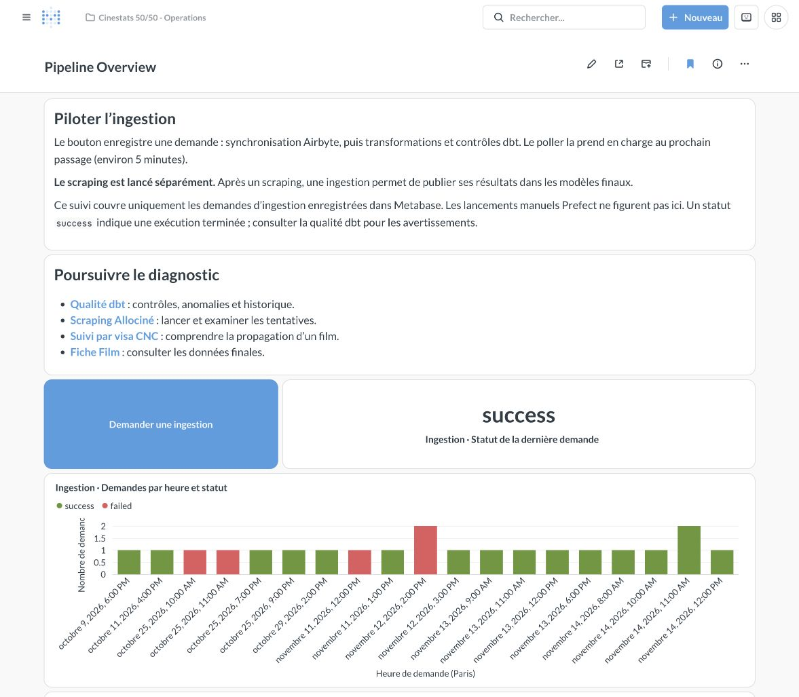
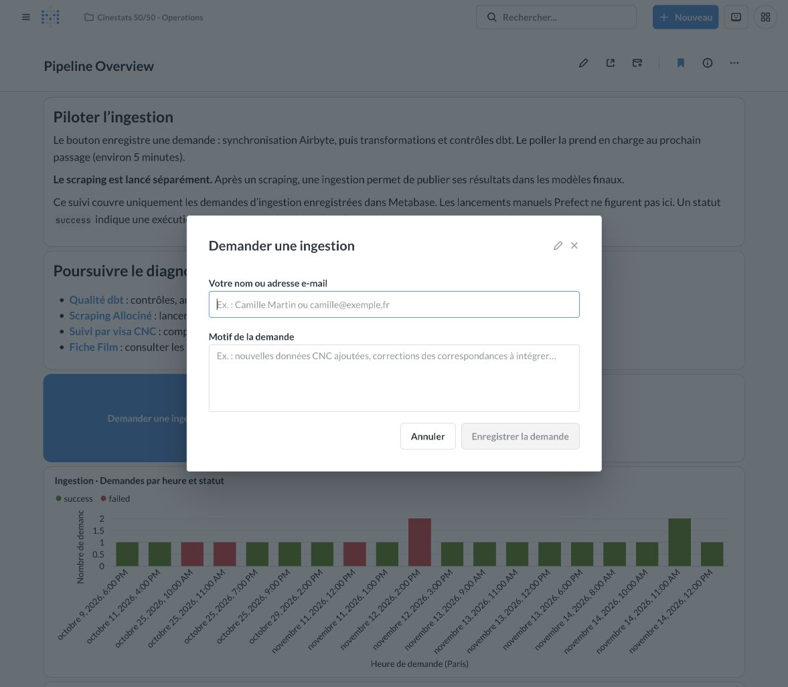
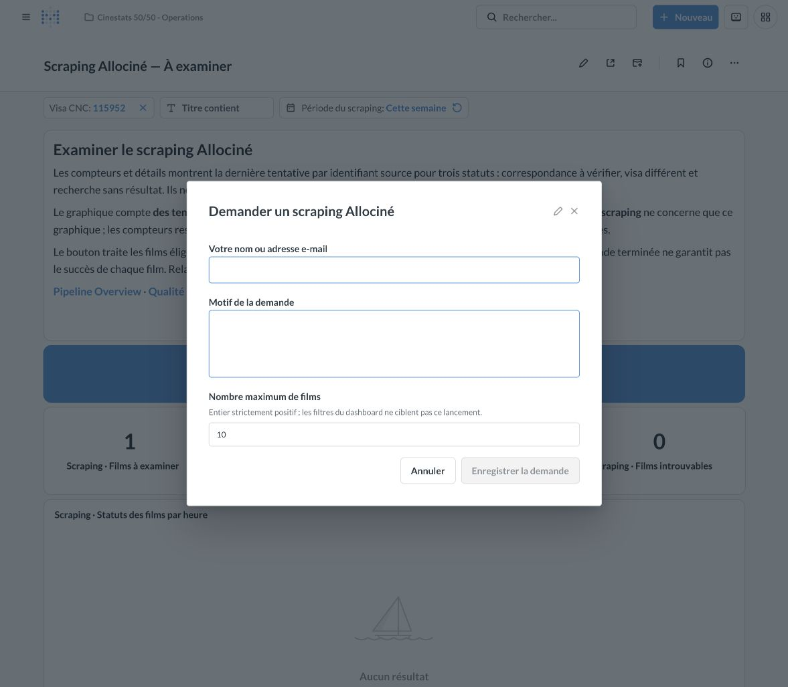

# Revoir une correspondance Allociné

**Owner:** Joel Teixeira  
**Dernière révision:** 2026-11-14  
**Status:** actif

## Objectif

Public : équipes métier Cinéstats 50/50.

Résoudre une correspondance signalée dans Metabase. Vérifier le film, documenter la décision, puis suivre sa publication. Aucun accès technique n’est nécessaire pour le parcours courant.

Les captures datent du 14 novembre 2026. Les vues du dashboard et du formulaire par lot précèdent l’ajout du deuxième bouton ; ce bouton est décrit dans les étapes ci-dessous. Les chiffres peuvent évoluer. L’exemple « Steak » est réel. Les écrans ont été consultés uniquement. Aucune validation ni demande n’a été envoyée pour ce tutoriel. Les résultats après traitement décrivent les contrôles attendus.

## Préparer ses accès

Ouvrir ces trois espaces :

- [Metabase Operations](https://metabase.cinestats5050.fr/collection/7-cinestats-50-50-operations).
- [Source de données — id_matching](https://docs.google.com/spreadsheets/d/1mvKPVrZ3FAHuUB__3akr4Fr7K4MqgTba9bFwNdtL_To/edit#gid=902822468), avec droit de modification.
- Les fiches publiques CNC et Allociné.

Un accès manque ? Contacter le référent data. Garder le visa et le titre.

## Retenir le parcours

**Repérer → Rechercher → Décider → Renseigner le Sheet → Scraper un visa CNC → Suivre la demande → Contrôler la publication.**

| Action | Son effet |
| --- | --- |
| Modifier le Sheet | Enregistre la correction ou validation. |
| Demander une ingestion | Récupère le Sheet et actualise les données publiées avec les collectes déjà disponibles. |
| Scraper un visa CNC | Récupère le Sheet, collecte uniquement le visa saisi, puis publie les données. |
| Forcer le retraitement : Oui | Rejoue ce visa même s’il est déjà traité ; conserve l’historique et les contrôles de correspondance. |
| Lancer le scraping Allociné | Récupère le Sheet, puis collecte un lot de fiches éligibles. Publication séparée nécessaire. |
| Demander une ingestion après scraping | Publie les nouveaux résultats collectés. |

**Cocher une case ne lance rien.** Après enregistrement du Sheet, envoyer une demande. Le bouton **Scraper un visa CNC** enchaîne synchronisation, collecte ciblée et publication. Le bouton **Demander une ingestion** ne lance aucun scraping.

## 1. Repérer le besoin dans Metabase

1. Ouvrir [Scraping Allociné — À examiner](https://metabase.cinestats5050.fr/dashboard/7).
2. Regarder les compteurs et tableaux.
3. Choisir un film à examiner.
4. Saisir son **Visa CNC** exact. Valider avec Entrée.
5. Descendre au tableau de détails concerné.
6. Relever titre, visa, ID Allociné et motif.



*Repère : « Visa CNC » isole un film. « Titre contient » aide à rechercher.*

| Signal affiché | Signification | Travail métier |
| --- | --- | --- |
| Correspondances à vérifier — `needs_review` | Le rapprochement n’a pas pu être confirmé. Plusieurs films peuvent être proposés. | Rechercher l’œuvre et identifier sa bonne fiche. |
| Visas différents — `visa_mismatch` | Allociné présente un autre numéro de visa. | Vérifier s’il s’agit bien du même film. |
| Films introuvables — `not_found` | La recherche n’a rien trouvé. | Rechercher manuellement. Transmettre au référent si la reprise reste bloquée. |

Une ligne vide côté Allociné peut correspondre à plusieurs candidats. Lire le motif complet. Ne pas prendre le premier candidat par défaut.

Le filtre « Période du scraping » concerne uniquement le graphique. Les tableaux peuvent montrer des anomalies anciennes. Un graphique vide ne prouve pas leur résolution.

### Exemple : « Steak »

Ouvrir [l’exemple filtré sur 115952](https://metabase.cinestats5050.fr/dashboard/7?visa=115952).



*Repère : tableau « Visas différents — détails ».*

| Élément | Valeur observée |
| --- | --- |
| Titre CNC | Steak |
| Visa CNC | 115952 |
| ID Allociné | 110872 |
| Visa affiché par Allociné | 107925 |
| Réalisation Allociné | Quentin Dupieux |

Le signal demande une vérification. Il ne prouve pas une mauvaise correspondance.

## 2. Rechercher et comparer les preuves

1. Ouvrir le lien Allociné du tableau. Faire défiler horizontalement si nécessaire.
2. Rechercher le visa dans [Visas et classification CNC](https://www.cnc.fr/professionnels/visas-et-classification).
3. Comparer les informations ci-dessous.
4. En cas de doute, consulter le distributeur ou un dossier de presse.
5. Conserver les liens dans votre commentaire.

| Information | Vérification attendue |
| --- | --- |
| Titre | Même œuvre ; vérifier les titres alternatifs. |
| Réalisation | Même personne ou équipe de réalisation. |
| Année et sortie en salle | Dates compatibles ; distinguer salle, télévision et vidéo. |
| Pays, distribution, synopsis | Indices concordants ; écarter homonymes et remakes. |
| Visa | Noter les deux valeurs si différentes. |

Un titre identique ne suffit pas. Une différence de durée mérite examen. Elle ne tranche pas seule l’identité.

Pour « Steak », la [fiche CNC](https://www.cnc.fr/professionnels/visas-et-classification/115952) présente Quentin Dupieux, le visa 115952 et la sortie du 20 juin 2007.



La [fiche Allociné 110872](https://www.allocine.fr/film/fichefilm_gen_cfilm=110872.html) présente le même titre, le même réalisateur et la même sortie en salle. Elle indique pourtant le visa 107925. Les durées diffèrent : CNC 84 minutes, Allociné 82 minutes. L’ensemble soutient le rapprochement. Le visa CNC reste la référence conservée.



*Repère : « N° de Visa », dans « Infos techniques ».*

### Décider avant de modifier

| Conclusion de recherche | Décision |
| --- | --- |
| Bonne fiche, malgré un écart de visa | Conserver l’ID ; documenter puis valider manuellement. |
| Mauvaise fiche ; bonne fiche retrouvée | Corriger l’ID ; valider uniquement après vérification. |
| Plusieurs fiches plausibles | Laisser la validation décochée ; demander un second avis. |
| Aucune preuve suffisante | Documenter le doute ; conserver le cas ouvert. |
| Erreur d’affichage ou collecte bloquée | Transmettre au référent data. Une validation ne répare pas une panne. |

## 3. Renseigner la décision dans Google Sheets

1. Ouvrir l’onglet **id_matching**.
2. Rechercher le visa avec Ctrl+F ou ⌘F.
3. Vérifier le titre sur la même ligne.
4. Décocher **VALIDATION_MANUELLE** avant tout changement d’identité.
5. Compléter les champs ci-dessous.
6. Cocher uniquement après vérification concluante.
7. Attendre l’indication d’enregistrement dans Drive.

Ne pas trier une colonne seule. Ne pas créer une seconde ligne pour le même visa. Ne pas modifier le visa pour effacer l’alerte.



*Repère : visa 115952 et ID 110872. Ligne 994 lors de la capture. Rechercher toujours le visa : les lignes peuvent bouger.*



*Repère : colonnes F à K. La case K994 est décochée dans l’état observé.*

| Colonne actuelle | Action métier |
| --- | --- |
| A — VISA | Conserver le visa CNC vérifié. Pour une correction de visa, contacter le référent data. |
| B — TITRE | Vérifier l’œuvre concernée. |
| C — ID ALLOCINE | Renseigner uniquement le nombre. Exemple : `110872`, extrait de l’adresse de la fiche. |
| F — UPDATED DATE | Saisir date et heure de revue. Exemple de format : `14/11/2026 14:30:00`. Utiliser l’heure réelle. |
| G — UPDATED BY | Renseigner votre nom. |
| H — COMMENTAIRES | Ajouter décision, preuves et liens. Conserver les remarques utiles précédentes. |
| I et J — CHECK DOUBLON… | Conserver les contrôles existants. Signaler un doublon au référent. |
| K — VALIDATION_MANUELLE | Cocher si l’ID renseigné désigne l’œuvre confirmée. Sinon laisser décoché. |

### Commentaire proposé pour « Steak »

À utiliser après votre propre vérification :

> Correspondance confirmée : Steak, Quentin Dupieux, sortie salle 20/06/2007. CNC : visa 115952 ; Allociné 110872 : visa affiché 107925. Titres, réalisation et sortie concordent. Durées différentes : 84/82 minutes. Visa CNC conservé. Sources : https://www.cnc.fr/professionnels/visas-et-classification/115952 et https://www.allocine.fr/film/fichefilm_gen_cfilm=110872.html. Revue : [date, heure, nom].

La validation concerne le rapprochement des œuvres. Elle ne certifie pas tous les champs Allociné. Après changement d’ID, refaire la vérification. La case ne mémorise pas l’ancienne identité.

### Autre cas : `needs_review`

Exemple observé : **Macunaima XXI**, visa **164876**, ID proposé **324310**. Le motif compare deux réalisateurs côté CNC avec un seul côté Allociné. Aucun visa concordant n’est disponible.

Rechercher la fiche et les crédits officiels. Confirmer la version exacte de l’œuvre. Si les preuves suffisent, renseigner l’ID puis justifier la validation. Sinon, laisser décoché et transmettre le dossier. Aucun choix n’est validé dans cet exemple.

## 4. Lancer le parcours pour votre visa

Après enregistrement du Sheet, choisir le bouton adapté.

| Situation | Action |
| --- | --- |
| Validation d’un `visa_mismatch` ou `needs_review` | **Scraper un visa CNC**, avec **Non** pour le forçage en premier choix. |
| Correction ou ajout d’ID Allociné | **Scraper un visa CNC**, avec **Non** en premier choix. |
| Nouvelle collecte nécessaire malgré un traitement déjà terminé | **Scraper un visa CNC**, avec **Oui** après vérification de l’identité. |
| Collecte déjà réussie ; données seulement non publiées | **Demander une ingestion** dans Pipeline Overview. |
| Doute sur l’identité ou preuves insuffisantes | Garder le dossier ouvert ; demander un second avis. |
| Erreur technique ou blocage persistant | Transmettre au référent data avec le visa et le message. |

### Parcours recommandé : « Scraper un visa CNC »

1. Ouvrir [Scraping Allociné — À examiner](https://metabase.cinestats5050.fr/dashboard/7).
2. Cliquer le deuxième bouton **Scraper un visa CNC**.
3. Renseigner votre nom ou adresse e-mail et un motif précis.
4. Saisir le **Visa CNC** dans le formulaire. Exemple : `115952` pour « Steak ».
5. Laisser **Forcer le retraitement** sur **Non**, sauf reprise volontaire d’un traitement terminé.
6. Vérifier le visa et le motif, puis cliquer **Enregistrer la demande**.
7. Suivre la table **Demandes de scraping Allociné**.

**Le filtre visa du dashboard ne préremplit pas le formulaire.** Saisir le visa explicitement. Utiliser le visa CNC, jamais l’ID Allociné.

Le parcours récupère d’abord les modifications du Sheet, collecte uniquement le visa demandé, puis publie les enrichissements. **Aucune ingestion séparée n’est nécessaire avant ou après ce bouton.** Attendre la fin de la demande avant de contrôler la Fiche Film.

**Forcer le retraitement : Oui** conserve les tentatives précédentes. Cette option ne valide pas le rapprochement et ne désactive pas les contrôles d’identité. Elle peut donc encore produire `visa_mismatch`, `needs_review`, `not_found`, `error` ou `blocked`.

Sans film éligible, la demande échoue : vérifier la présence du visa dans le Sheet et si le film a déjà été traité. Si une nouvelle collecte est réellement nécessaire, renvoyer une demande avec **Oui**. En cas de résultat non confirmé, lire le motif avant toute nouvelle demande ; la publication automatique n’est pas exécutée.

### Autre parcours : traiter un lot

Le bouton existant **Lancer le scraping Allociné** reste disponible. Il demande identité, motif et nombre maximum de films (10 par défaut). Il récupère d’abord les modifications du Sheet, puis traite des films éligibles ; même avec une limite de 1, il ne garantit pas votre film.

Aucune ingestion préalable n’est nécessaire : le bouton attend lui-même la synchronisation du Sheet. Après le lot, demander une ingestion dans [Pipeline Overview](https://metabase.cinestats5050.fr/dashboard/2) pour publier les résultats. Si la synchronisation échoue, le scraping ne démarre pas.







*Cette capture montre le formulaire par lot. Le deuxième bouton demande un visa et le choix de forçage à la place du volume.*

## 5. Suivre la demande

Le poller prend en charge les demandes environ toutes les cinq minutes. Un traitement en attente ou un worker indisponible peut allonger ce délai. Éviter les envois répétés.

Une seule demande Allociné peut rester active, quel que soit le bouton. Si l’envoi est refusé, consulter la demande existante. La table indique le visa demandé et le choix de forçage pour le parcours ciblé.

| État | Lecture métier |
| --- | --- |
| En attente | Demande enregistrée, pas encore prise en charge. |
| Transmise / en cours | Demande transmise à Prefect ; elle peut encore attendre le worker. |
| Terminée — par visa | Collecte confirmée puis publication réussie. Vérifier les champs attendus dans la Fiche Film. |
| Terminée — par lot | Fin technique normale ; certains films peuvent avoir échoué et le lot peut être vide. Publication séparée nécessaire. |
| Échec | Consulter le message et les détails du film ; transmettre au référent avec l’identifiant de demande si nécessaire. |

Un lancement effectué directement dans Prefect peut être absent de cette table. Une demande par visa échoue si la synchronisation, la collecte confirmée ou la publication échoue. Les tentatives non confirmées restent visibles dans les tableaux et le suivi par visa.

## 6. Publier et vérifier le résultat

1. Actualiser la file de revue.
2. Filtrer à nouveau votre visa.
3. Vérifier la disparition de l’anomalie.
4. Consulter le suivi par visa. Vérifier un nouveau succès sur le bon ID.
5. Après le bouton par visa, vérifier que la demande est **Terminée** : la publication est incluse.
6. Après un lot uniquement, demander une ingestion dans **Pipeline Overview** et attendre sa réussite.
7. Ouvrir [Qualité des données — dbt](https://metabase.cinestats5050.fr/dashboard/3). Examiner les alertes du traitement concerné.
8. Ouvrir [Fiche Film](https://metabase.cinestats5050.fr/dashboard/9?visa=115952). Vérifier les informations attendues.

Pour un écart accepté, les deux visas restent conservés. La disparition de l’anomalie peut précéder la publication. Elle ne remplace pas ce contrôle final.

### Clôturer le dossier

- [ ] Identité confirmée avec preuves.
- [ ] Bon ID présent dans le Sheet.
- [ ] Commentaire, auteur et date renseignés.
- [ ] Validation cohérente avec la décision.
- [ ] Modification du Sheet récupérée par le parcours choisi.
- [ ] Nouveau succès sur le bon film, si collecte nécessaire.
- [ ] Anomalie absente après actualisation.
- [ ] Publication réussie : incluse dans la demande par visa, ou ingestion séparée après un lot.
- [ ] Fiche Film contrôlée ; réserves documentées.

Ces résultats sont attendus pour « Steak ». Aucun résultat après validation n’a été produit pour illustrer ce guide.

## Quand demander de l’aide

| Problème | Informations à transmettre au référent data |
| --- | --- |
| Preuves contradictoires | Visa, titre, liens et points de désaccord. |
| Correction absente après ingestion | Lien du Sheet, visa, heure de modification, demande concernée. |
| Film encore en revue après scraping | Visa, ID, dernière tentative et motif. Vérifier le visa demandé ou, pour un lot, que le film a été traité. |
| Demande longtemps en attente | Identifiant et heure de demande. |
| Échec ou erreur de collecte | Identifiant de demande, message et visa. |
| Film absent ou incorrect après publication | Visa, champs attendus, preuves et demande d’ingestion. |

Garder les preuves dans **COMMENTAIRES**. Metabase ne constitue pas un journal complet des décisions humaines.

## Où retrouver ce tutoriel

Le [guide métier est publié dans Metabase Operations](https://metabase.cinestats5050.fr/document/1).

Un lien figure sur cinq dashboards : Pipeline Overview, Scraping Allociné — À examiner, Qualité des données — dbt, Suivi des données par visa CNC et Fiche Film.

Le présent fichier est la source versionnée. Le document Metabase reprend les étapes métier et les captures existantes ; le nouveau formulaire ciblé est décrit en texte. Les tableaux y sont présentés en listes. Après modification du guide, republier avec le script de maintenance ci-dessous. Les captures utilisent les URL du dépôt public, figées sur un commit publié de `main` ; conserver ces fichiers accessibles.

## Références de maintenance

Équipes métier : les étapes ci-dessus suffisent. Référent data : [fonctionnement de la revue](../../ingestion/dbt/README.md#examiner-les-correspondances-du-scraping-dans-metabase) et [reprise après validation](../../ingestion/scraping/allocine/README.md#reprendre-une-correspondance-validée-manuellement).

Depuis la racine, le référent data peut vérifier puis republier :

```bash
python3 infra/data/metabase-review-tutorial.py --env-file ingestion/.env
python3 infra/data/metabase-review-tutorial.py --env-file ingestion/.env --apply
```

La clé API reste dans l’environnement ou le fichier local hors Git. Le script actualise le document existant par son nom et sa collection. Il ajoute ou met à jour les liens, sans lancer d’ingestion ni de scraping. Publier les captures sur `main`, puis vérifier leur affichage dans Metabase. Le script utilise le commit local `origin/main` pour leurs liens : actualiser cette référence avant republication. `--image-ref <commit-publié>` permet de choisir explicitement leur version.

Captures authentiques des interfaces. Aucun écran de réussite simulé. Les captures historiques des tableaux et du formulaire par lot restent des repères ; se fier aux étapes actuelles pour le bouton par visa.

## Historique du document

| # | Date | Auteur | Observations |
| --- | --- | --- | --- |
| 1 | 2026-11-14 | Joel Teixeira | Guide métier illustré : recherche, décision, Sheet, ingestion, collecte et contrôle de publication. Exemple réel Steak et cas needs_review. Publication native dans Operations et liens sur cinq dashboards. |
| 2 | 2026-11-14 | Joel Teixeira | Parcours par visa dans Metabase, forçage explicite, synchronisation et publication automatiques ; distinction avec le bouton par lot. |
| 3 | 2026-11-14 | Joel Teixeira | Synchronisation Airbyte incluse avant le scraping par lot ; publication séparée conservée. |
