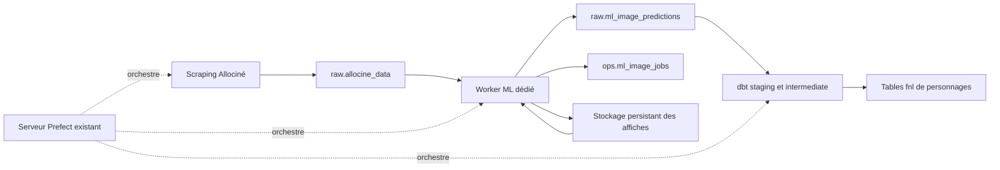

# Plan d’implémentation — ML image, PostgreSQL, Prefect et dbt

**Owner:** Joel
**Dernière révision:** 2026-10-15
**Status:** brouillon

## Objectif et périmètre

Déployer `ml-image` dans un environnement Docker reproductible, orchestré par l’instance Prefect existante. Le module doit lire ses entrées dans PostgreSQL et écrire ses prédictions dans une table dédiée du schéma `raw`. dbt transforme ensuite ces résultats et publie les tables finales.

Le parcours de production ne dépend pas de CSV. Les CSV restent autorisés comme fixtures de test. L’exécution CPU constitue le socle ; une variante CUDA permet l’accélération sur un hôte compatible.

Les affiches de référence sont conservées sur un système de fichiers persistant, sans MinIO au démarrage. Une seule représentation sans perte supplémentaire est conservée par contenu : AVIF sans perte si sa taille est inférieure et ses pixels vérifiés, sinon fichier original. Les expériences réutilisent cette référence immuable.

Ce document décrit une cible à implémenter. Il ne constitue pas une validation de déploiement ni de qualité des prédictions. Le backend utilise encore les tables `ric_*` : sa migration vers les tables finales dbt reste un chantier distinct.

## État actuel et prérequis

- L’inférence et les exports locaux existent. Le test CPU documenté porte sur un extrait de dix secondes ; il ne valide pas la qualité des classifications.
- La CLI de production actuelle dépend d’un CSV et produit des pickle et CSV locaux.
- Les exceptions par film sont interceptées sans faire échouer correctement le traitement global. Les détections vides et la catégorie d’âge `70+` peuvent provoquer des erreurs.
- Toutes les images vidéo sont chargées en mémoire. Le dimensionnement doit être revu avant traitement de bandes-annonces complètes.
- Le scraper Allociné extrait `poster_url`, mais son connecteur ne persiste pas ce champ dans `raw.allocine_data`. `trailer_url` est déjà persisté.
- L’ingestion dispose d’un serveur Prefect et d’un worker de type `process`. Le ML n’y est pas raccordé.
- Le Dockerfile ML utilise les dépendances historiques et n’est pas validé par le test CPU local.
- Le script de livraison data copie uniquement `ingestion/` ; il ne livre pas actuellement `ml-image/`.
- Le VPS data documenté possède 4 vCPU et 8 Go de mémoire, partagés avec les autres services. Sa capacité ML et la présence éventuelle d’un GPU restent à vérifier.

Références : [guide ML](../../ml-image/README.md), [architecture implémentée](../architecture/ml-image-architecture-description-pipeline-phase-1.md), [guide ingestion](../../ingestion/README.md), [runbook data](../runbooks/stack-data.md).

## Architecture cible

Le worker ML possède son image et son pool Prefect. Il partage le serveur Prefect existant, mais conserve ses dépendances et ses ressources propres. dbt continue de s’exécuter dans le runtime ingestion.

## 1. Compléter les données source

1. Ajouter `poster_url` au contrat, à la table et aux écritures du connecteur Allociné.
2. Prévoir une migration explicite pour les installations existantes : `CREATE TABLE IF NOT EXISTS` seul n’ajoute pas une colonne.
3. Backfiller les affiches des films déjà collectés. Le scraper évite actuellement les enregistrements terminés ; le backfill doit donc être explicite et ciblé.
4. Définir une sélection déterministe de la dernière collecte réussie par film, avec départage stable des égalités.
5. Valider les URL et distinguer médias absents, médias invalides et erreurs temporaires de téléchargement. La politique de traitement vidéo seule doit être fixée avant implémentation ; le parcours actuel attend les deux médias.

## 2. Définir les contrats PostgreSQL

Les noms suivants sont proposés pour les nouvelles tables.

| Table | Responsabilité |
| --- | --- |
| `ops.ml_image_jobs` | Entrées figées, état de traitement, tentatives, bail de réservation, erreurs et identifiant du run Prefect |
| `raw.ml_image_predictions` | Résultats réussis, provenance et métadonnées de reproductibilité |
| `raw.ml_image_poster_assets` | Catalogue des fichiers d’affiches immuables, empreintes et métadonnées de décodage |
| `raw.ml_image_poster_sources` | Provenance des acquisitions et associations entre films, collectes et fichiers |

### Entrées et suivi des traitements

Chaque job conserve les identifiants source (`visa_number`, `allocine_id`), la référence de collecte, les URL retenues, la version du pipeline, les modèles et la configuration. Les entrées sont figées à la création du job.

La référence `poster_asset_id` est fixée après acquisition et validation, avant l’inférence. Les retries et les expériences comparatives réutilisent cette référence plutôt que de télécharger à nouveau l’URL. Les prédictions conservent aussi cet identifiant ; la suppression d’un asset référencé est interdite.

Prévoir des états explicites : en attente, en cours, réussi, échoué et ignoré, avec motif. Conserver les timestamps, le nombre de tentatives, le propriétaire du bail, son expiration et l’identifiant du run Prefect. Une erreur technique ne doit pas devenir un résultat réussi vide.

### Prédictions brutes

Conserver une ligne par analyse réussie d’un film, contenant :

- identifiant du job et identifiants source ;
- URL des médias et empreintes de leur contenu ;
- version du code, empreintes des poids, paramètres et appareil utilisé ;
- timestamps et version du schéma du payload ;
- tableaux JSONB des personnages vidéo et des détections affiche ;
- résultat explicite pour une analyse réussie sans détection.

Ne pas stocker les images, crops ou embeddings dans PostgreSQL. Les éventuels artefacts de diagnostic ont une rétention distincte. Les identifiants de personnages restent locaux à une analyse ; ils ne constituent pas des identités stables entre films ou versions.

dbt résout le `film_id` canonique à partir des identifiants source et des modèles de matching existants.

### Idempotence et transactions

Définir une clé unique de travail à partir du film, de la version des entrées, des modèles et de la configuration. Les empreintes des médias téléchargés complètent la provenance ; une politique de rafraîchissement doit couvrir les contenus modifiés derrière une URL inchangée.

Réserver atomiquement les jobs avec un bail expirant. Effectuer téléchargements et inférence hors transaction longue. Valider ensemble les prédictions et le statut réussi. Utiliser un jeton de réservation pour empêcher un worker dont le bail a expiré d’écraser une tentative plus récente.

Les reprises ne doivent pas dupliquer les résultats. Conserver les analyses antérieures pour la traçabilité ; une nouvelle tentative échouée ne remplace pas une analyse réussie.

Créer les tables et les droits via une migration versionnée distincte du runtime. Le compte dédié `ml_image_user` lit les seules sources nécessaires et écrit les tables ML prévues. dbt dispose des droits de lecture nécessaires.

## 3. Refactorer le parcours ML

1. Extraire une fonction d’inférence acceptant des chemins de médias et une configuration, puis retournant des prédictions structurées.
2. Ajouter un point d’entrée PostgreSQL qui sélectionne et réserve un lot borné de films.
3. Supprimer les dépendances aux CSV et pickle intermédiaires dans ce parcours de production.
4. Borner les téléchargements : délais, taille, contrôle HTTP et validation du média.
5. Traiter explicitement vidéos invalides, FPS nuls, détections vides et âges ouverts tels que `70+`.
6. Remplacer le chargement intégral des frames par un traitement borné en mémoire et vérifier aussi la mémoire des détections et embeddings.
7. Réutiliser les modèles dans un lot lorsque possible, nettoyer les fichiers temporaires et remonter les échecs avec un bilan fiable.
8. Ajouter `--device auto|cpu|cuda`. Une demande explicite de CUDA doit échouer clairement si CUDA est indisponible.

Les corrections qualitatives — conversion BGR/RGB, seuil de rejet affiche/vidéo, pondération et mesure du temps à l’écran — doivent être évaluées et versionnées avant publication de résultats approuvés.

## 4. Intégrer Prefect

Créer le pool `ml-image-pool` et le deployment `lancer-analyse-images` sur le serveur existant. Un worker de type `process` dans le conteneur ML exécute les flows en sous-processus dans cet environnement.

Commencer avec une concurrence de 1, des lots bornés, des timeouts et des retries réservés aux erreurs temporaires. Les paramètres permettent de sélectionner un sous-ensemble de films et de lancer un backfill contrôlé.

Le flow d’orchestration ingestion déclenche le deployment ML, attend son état terminal, puis déclenche le traitement dbt dédié dans le runtime ingestion. En cas d’échec partiel, les films réussis peuvent être transformés, mais le bilan doit conserver les échecs et ne pas annoncer une réussite globale trompeuse. Prévoir un verrou de publication si plusieurs flows peuvent reconstruire les mêmes tables dbt.

Conserver les données métier et le suivi durable dans PostgreSQL ; transmettre à Prefect les identifiants et compteurs, sans payloads volumineux. Tester la reprise après arrêt du conteneur et expiration d’un bail.

Publier d’abord le deployment pour des lancements manuels. Activer un schedule seulement après mesure des ressources et validation des reprises. Aligner la version Prefect du worker ML sur celle du serveur.

## 5. Construire et déployer avec Docker Compose

Le Dockerfile définit l’environnement reproductible. Compose définit les services, le réseau, les secrets injectés, les volumes, les limites de ressources et l’accès GPU éventuel.

Livrables prévus :

- Dockerfile ML avec variantes Linux CPU et CUDA testées ;
- dépendances verrouillées par variante et bases épinglées ;
- manifeste de modèles avec provenance et sommes de contrôle ;
- provisionnement explicite des poids, sans téléchargement implicite à la première inférence ;
- code embarqué dans l’image, utilisateur non privilégié et absence de bind mount du code en production ;
- service ML optionnel dans `ingestion/docker-compose.yml` ;
- surcharge Compose GPU séparée avec réservation explicite du périphérique ;
- configuration d’environnement documentée et contrôlée au démarrage ;
- stockage temporaire borné et nettoyage garanti ;
- stockage persistant des affiches monté séparément, avec sauvegarde hors hôte selon le contrat ci-dessous ;
- livraison par image immuable référencée par digest, ou extension explicite du packaging actuel pour inclure `ml-image/`.

Le CPU reste utilisable sans configuration GPU. La variante CUDA exige un hôte NVIDIA et un runtime Docker compatibles. Tester l’exécution Linux sans contexte graphique ; la validation macOS locale ne couvre pas ce cas.

Mesurer RAM, CPU, durée et espace disque sur des bandes-annonces complètes avant de fixer les limites Compose. Si le VPS data ne dispose pas de capacité suffisante, héberger le worker ailleurs et le connecter au serveur Prefect et à PostgreSQL par le réseau privé prévu.

### Stocker les affiches sur le système de fichiers

#### Implantation et accès

Prévoir un répertoire hôte dédié, par exemple `/srv/ric/ml-image/posters`, monté dans le conteneur sous `/data/posters`. Le paramètre proposé `ML_IMAGE_POSTER_ROOT=/data/posters` désigne cette racine. Ce répertoire est indépendant de l’image Docker, du checkout Git et des fichiers temporaires nettoyés après traitement.

Les fichiers utilisent une clé relative calculée par le programme, par exemple `sha256/ab/cd/<sha256-fichier>.avif`. Les fragments `ab/cd` correspondent aux premiers caractères de l’empreinte. Ne pas construire de chemin à partir d’un titre ou d’une URL. PostgreSQL conserve cette clé relative ; le chemin absolu reste propre au déploiement.

Le processus d’acquisition dispose de droits d’écriture. Les consommateurs qui lisent seulement les affiches utilisent un montage en lecture seule. Aucun port de stockage supplémentaire n’est nécessaire. Un redéploiement du service ne supprime pas les fichiers.

#### Choisir la représentation sans perte

1. Télécharger l’affiche dans un fichier temporaire avec contrôles HTTP, taille maximale, dimensions et décodage valide.
2. Calculer l’empreinte SHA-256 du fichier source. Définir et versionner le contrat de décodage : orientation, espace colorimétrique, profondeur et alpha. Conserver les métadonnées nécessaires à la restitution ; une image hors du contrat pris en charge reste dans son format original.
3. Produire un candidat AVIF avec un encodeur explicitement configuré sans perte. Un réglage de qualité élevé seul ne constitue pas une preuve d’absence de perte.
4. Décoder l’original et le candidat selon le même contrat. Exiger l’égalité exacte des dimensions, canaux et valeurs des pixels. Vérifier que le runtime Docker ML sait décoder le fichier retenu.
5. Retenir l’AVIF uniquement si ces contrôles passent et que sa taille est strictement inférieure. Sinon conserver l’original téléchargé. Ne pas imposer un gain de compression prévisionnel.
6. Publier une seule représentation de référence. Supprimer les fichiers temporaires après publication et enregistrement réussis.

« Sans perte » signifie ici aucune altération supplémentaire des pixels décodés selon ce contrat. Cela ne restaure pas les détails déjà perdus dans un JPEG source et ne signifie pas que les octets du fichier original restent conservés. Si l’AVIF est retenu, l’empreinte et la provenance du fichier source subsistent, mais sa copie binaire n’est pas archivée séparément.

#### Catalogue, provenance et déduplication

`raw.ml_image_poster_assets` conserve au minimum : `poster_asset_id`, backend de stockage, clé relative, SHA-256 du fichier stocké, empreinte des pixels avec version du contrat de décodage, type MIME, taille en octets, dimensions, informations de couleur et d’alpha, date de création, version de l’encodeur et paramètres éventuels.

`raw.ml_image_poster_sources` conserve le lien vers l’asset, les identifiants du film, la référence de collecte, l’URL source, la date d’acquisition et le SHA-256 du fichier téléchargé. Plusieurs films ou acquisitions peuvent ainsi référencer un même asset sans dupliquer le fichier.

Dédupliquer les fichiers identiques par SHA-256. Une réutilisation fondée sur les pixels exige aussi le même contrat de décodage et des métadonnées de restitution compatibles. Une nouvelle collecte avec un contenu différent crée un nouvel asset ; elle ne remplace jamais un fichier déjà utilisé par une expérience.

#### Publication et reprise

Écrire le fichier temporaire sur le même système de fichiers que sa destination, puis effectuer une publication atomique sans écraser un objet existant. Vérifier l’empreinte d’un objet déjà présent avant de le réutiliser. N’enregistrer une référence exploitable en base qu’après publication du fichier.

Le système de fichiers et PostgreSQL ne partagent pas une transaction. Prévoir une réconciliation : détecter les fichiers publiés sans référence après un crash, les références manquantes sur disque et les corruptions. Les orphelins ne sont supprimés qu’après un délai de grâce configuré et vérification de l’absence de job actif. Un fichier absent ou corrompu bloque l’analyse concernée avec une erreur explicite.

#### Conservation, sauvegarde et capacité

Conserver les affiches référencées par des jobs, prédictions ou jeux de comparaison. Le nettoyage des fichiers temporaires ne touche jamais ce stockage. Les crops et visualisations restent des artefacts distincts avec leur propre rétention.

Prévoir une sauvegarde quotidienne hors hôte des fichiers et du catalogue PostgreSQL, avec un objectif initial de perte maximale de 24 heures. Documenter la restauration conjointe et tester qu’un asset restauré retrouve sa référence et son empreinte. Un volume Docker ou une copie sur le même disque n’est pas une sauvegarde hors hôte.

Pour 350 films/an et une affiche de référence par film, une moyenne hypothétique de 500 Ko à 1 Mo représente environ 175 à 350 Mo/an, soit 1,75 à 3,5 Go sur dix ans, hors sauvegardes. Ce calcul n’est pas une mesure du corpus ni une promesse de compression AVIF. Prévoir une enveloppe initiale de 10 Go, surveiller occupation et espace libre, puis ajuster après échantillonnage. Les révisions d’affiches augmentent le nombre d’assets.

Cette capacité exclut les bandes-annonces. Pour une comparaison ML reproductible complète, leurs fichiers doivent eux aussi être figés et accessibles ; leur archivage et leur dimensionnement restent à spécifier séparément.

#### Préparer un accès depuis plusieurs machines

Isoler les opérations dans une interface de stockage (`put`, `get`, `exists`), avec une première implémentation locale. Le catalogue distingue le backend et la clé de l’objet, sans encoder le chemin hôte dans les données métier.

Un worker GPU installé ailleurs doit recevoir un accès aux mêmes fichiers vérifiés avant exécution ; la connexion PostgreSQL et Prefect seule ne suffit pas. Un stockage compatible S3, hébergé ou MinIO, pourra remplacer le backend local si plusieurs hôtes doivent partager les médias. La migration doit conserver les identifiants d’assets et vérifier leurs empreintes.

## 6. Transformer les résultats avec dbt

1. Déclarer `raw.ml_image_predictions` dans les sources.
2. Ajouter les modèles staging qui typent les champs et développent les tableaux JSONB.
3. Ajouter les modèles intermédiaires qui résolvent les identifiants et sélectionnent la dernière analyse réussie avec une version approuvée.
4. Construire les tables finales de personnages vidéo et affiche ; leurs noms et contrats détaillés restent à arrêter avant implémentation.
5. Ajouter un sélecteur explicite `ml_image` couvrant modèles, dépendances nécessaires et tests. Les tags `phase2` existants ne couvrent pas automatiquement ces nouveaux modèles.
6. Représenter un âge inconnu par des bornes nulles ; pour `70+`, conserver une borne inférieure de 70 et une borne supérieure ouverte.
7. Tester unicité, relations, statuts, bornes et cohérence des métriques. Prévoir une vue de suivi dans `ops` pour les volumes, erreurs et traitements en retard.

Les résultats bruts restent disponibles pour audit. Leur publication dans `fnl` dépend de l’approbation explicite de la version de modèle et de configuration.

## 7. Vérifier avant mise en production

| Validation | Critère d’acceptation |
| --- | --- |
| Construction CPU | Image Linux construite depuis un environnement propre, poids vérifiés, démarrage headless |
| Parcours PostgreSQL | Film sélectionné en base, médias traités, résultats persistés sans CSV |
| Idempotence | Relance sans doublons pour les mêmes entrées, modèles et paramètres |
| Reprise | Arrêt du worker, expiration du bail et nouvelle tentative sans écrasement concurrent |
| Cas limites | Médias absents ou invalides, détections vides et `70+` traités explicitement |
| Échec partiel | Réussites conservées, erreurs visibles, bilan Prefect fidèle |
| dbt | Sources, transformations et tests exécutés sur les résultats ML |
| Ressources | Mémoire et disque bornés sur des bandes-annonces complètes |
| Affiches sans perte | Égalité des pixels après décodage ; original retenu si AVIF plus gros ou non conforme |
| Stockage persistant | Fichiers disponibles après recréation du conteneur, déduplication et absence d’écrasement |
| Cohérence du catalogue | Reprise après crash entre publication du fichier et écriture SQL, détection des fichiers absents ou corrompus |
| Comparaison des expériences | Même `poster_asset_id` réutilisé ; nouvelle affiche conservée sous un autre identifiant |
| Sauvegarde | Restauration hors hôte testée avec catalogue, fichiers et empreintes cohérents |
| CUDA | Test distinct sur hôte compatible, appareil utilisé enregistré |
| Qualité | Évaluation sur annotations de référence avant approbation pour publication |

Les tests d’intégration utilisent une base dédiée ou l’environnement de validation explicitement identifié. Le passage en production doit inclure migration des tables, attribution des droits, installation de l’image, enregistrement du deployment, traitement d’un lot limité et contrôle des résultats dbt.

Pour revenir en arrière, suspendre les nouveaux runs, conserver les résultats et historiques, restaurer l’image précédente et sélectionner la dernière version approuvée pour la publication. Une désactivation du ML ne doit pas interrompre les autres flux d’ingestion.

## Ordre de livraison

1. Contrats SQL, ajout de `poster_url`, catalogue des affiches et stratégie de backfill.
2. Stockage persistant, vérification sans perte, sauvegarde, refactorisation ML et entrée/sortie PostgreSQL.
3. Images CPU/CUDA, poids vérifiés et Compose.
4. Worker dédié, orchestration Prefect et reprise des jobs.
5. Modèles dbt, suivi opérationnel et sélection des versions approuvées.
6. Validation sur environnement dédié, dimensionnement, puis activation progressive.

Chaque étape met à jour le guide du composant et ajoute les vérifications correspondantes. La disponibilité technique et la qualité statistique des prédictions constituent deux validations distinctes.

## Références techniques

- [Pipeline ML actuelle](../../ml-image/scripts/pipelines.py)
- [Connecteur Allociné](../../ingestion/scraping/allocine/connector.py)
- [Worker Prefect existant](../../ingestion/prefect/start_worker.sh)
- [Compose ingestion](../../ingestion/docker-compose.yml)
- [Livraison de la stack data](../../infra/data/deploy-ingestion.sh)
- [Documentation Prefect : workers](https://docs.prefect.io/v3/concepts/workers)
- [Documentation Docker : accès GPU avec Compose](https://docs.docker.com/compose/how-tos/gpu-support/)

## Historique du document

| # | Date | Auteur | Observations |
| --- | --- | --- | --- |
| 1 | 2026-10-15 | Joel | Plan initial de déploiement Docker, intégration PostgreSQL raw, orchestration Prefect et transformation dbt ; stockage local immuable des affiches, sélection sans perte, catalogue, sauvegarde et réutilisation entre expériences. |
